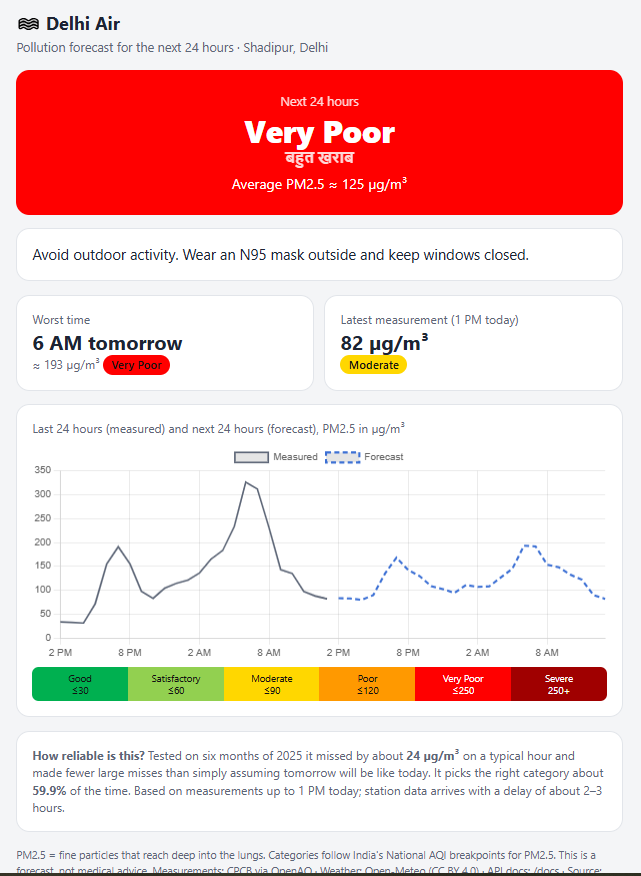

# 🌫️ Delhi Air: a live PM2.5 forecast anyone can read in 10 seconds

A production version of my [Delhi PM2.5 Forecaster](https://github.com/Alyasar/aqi-forecaster): a **FastAPI** service in **Docker** that pulls **live station measurements** and the **weather forecast** every hour, runs the model, and answers one question in plain language: *how bad will the air be in the next 24 hours, and what should I do?*

**🔗 Live:** [delhi-air.onrender.com](https://delhi-air.onrender.com/) · **API docs:** [/docs](https://delhi-air.onrender.com/docs)
_(free hosting: the first visit after a quiet period takes ~30–60 s to wake up)_



**For a non-technical visitor:** a colour-coded verdict (in English and Hindi, using CPCB's official category names), one sentence of health advice, the worst hour, the latest measurement, and a chart of the last 24 hours measured vs. the next 24 forecast.

---

## Results

### The servable model is as accurate as the original, with far fewer inputs

The original model used 48 features, including 11 pollutants. The live station feed only reliably provides PM2.5 (see [what made the live data messy](#what-made-the-live-data-messy)), so the product uses a **servable model** retrained on the same data with only the features it can fetch at serving time. Same data, same walk-forward monthly retraining, same test period (Jul–Dec 2025) as the original project:

| Model | Features | MAE | RMSE | R² | Category accuracy |
|---|---|---|---|---|---|
| Original P1 model (not servable) | 48 | 24.3 | 44.1 | 0.568 | 58.1% |
| **Servable: PM2.5 history + time + weather (deployed)** | **38** | **24.1** | **43.7** | **0.575** | **59.9%** |
| Servable + PM10 | 39 | 24.2 | 43.9 | 0.571 | 60.1% |
| Servable + PM10 + O₃ | 40 | 24.2 | 44.1 | 0.568 | 60.0% |
| Baseline: same as now | – | 23.4 | 49.7 | 0.451 | 59.0% |
| Baseline: last 24 h average | – | 23.9 | 46.2 | 0.525 | 59.7% |

MAE/RMSE in µg/m³ (lower is better). Full table: [`reports/evaluation.csv`](reports/evaluation.csv), notebook: [`notebooks/02_servable_model.ipynb`](notebooks/02_servable_model.ipynb).

- **Dropping 10 pollutants cost nothing** (RMSE 44.1 → 43.7): PM2.5's own history and the weather carry the signal. For a product, fewer live inputs means fewer things that can break.
- **Honest comparison with the baselines:** the model makes fewer large misses (best RMSE and R²), but "same as now" still has a slightly lower MAE, and category accuracy is about the same. Like most models trained with an absolute-error loss, it **underestimates extreme peaks** (e.g. 193 forecast vs. 326 measured on a smoggy morning).

### Why a station model at all: the global-model alternative is far off

The free CAMS global air-quality model (via Open-Meteo) for the same location, compared with the station over 71 live hours:

| | Station (measured) | CAMS (global model) |
|---|---|---|
| Average PM2.5 | **153** µg/m³ | 89 µg/m³ (−42%) |
| Morning smog peak (06:00) | **326** | 92 |
| Correlation | | 0.45 |

A global model can't see one neighbourhood's pollution; a model trained on the station's own history can. CAMS is kept only as a **clearly labelled fallback** when the station feed is down.

---

## How it works

```
                 ┌─────────────── Visitor's browser ───────────────┐
                 │ 1. fetch weather from Open-Meteo (own IP)       │
                 │ 2. POST /api/forecast {weather}                 │
                 └───────────────────────┬─────────────────────────┘
                                         ▼
┌──────────────────────────── FastAPI (Docker, Render) ─────────────────────────────┐
│ validate weather ─► OpenAQ: Shadipur PM2.5, last 96 h (cached 30 min, key server-side)│
│                  ─► build_features()  (same code as training: parity-tested)       │
│                  ─► model.predict() on the last 24 input hours → next 24 hours     │
│                  ─► category + plain-language advice                               │
│ fallback: station down/stale → CAMS estimate, clearly labelled                     │
└────────────────────────────────────────────────────────────────────────────────────┘
```

| Endpoint | What |
|---|---|
| `GET /` | The product page |
| `GET /api/forecast` | 24-hour forecast; the server fetches the weather itself (cached 30 min) |
| `POST /api/forecast` | Same, with weather supplied by the caller (used by the page) |
| `GET /health` | Health check (used by Docker and Render) |
| `GET /docs` | Interactive API docs, generated from the Pydantic models |

**One model, a 24-hour curve:** the model predicts PM2.5 exactly 24 hours after its input hour, so running it on each of the last 24 hours of station data yields a forecast for each of the next 24 hours.

---

## Engineering notes (what production taught me)

### What made the live data messy
- **Train/serve skew by design.** Only features available live were used for training; NH₃, benzene and toluene aren't reported by the live feed.
- **Mislabeled units.** The live gas sensors report "ppb", but the values don't fit (CO "0.8 ppb" is impossible in Delhi; it looks like mg/m³). Feeding them to a model trained on correct units would give silently wrong forecasts, so they're not used.
- **Dead sensor IDs.** The station lists two PM2.5 sensors and two "Shadipur" locations; one location stopped in 2018 and several sensor IDs return nothing. The code picks the sensor that actually has data instead of hard-coding an ID.
- **Data delay.** Station data arrives ~2–3 hours late; the page says "based on measurements up to …" and the headline only covers hours still to come.

### A parity test caught a silent bug
[`tests/test_features.py`](tests/test_features.py) runs the **live feature code on the training history** and requires every shared feature to match the training features **exactly**, on all 15,304 hours. My first version filled short sensor gaps by interpolation (as the original README describes); the test showed the actual training data had *not* filled them, so 3 rolling features differed on 259 hours. That is exactly the kind of skew that degrades a model in production without any error.

### "Works on my machine": rate limits on shared cloud IPs
Locally everything worked; on Render, Open-Meteo answered **HTTP 429 Too Many Requests**. Cloud servers share outbound IPs with other apps, and the shared IP was over Open-Meteo's free limit.
1. First fix: retries with exponential backoff (honouring `Retry-After`) and a 2-hour weather cache. Measured result: still 429, because the limit was persistent, not a burst.
2. Redesign: the **visitor's browser fetches the weather** (its own IP; Open-Meteo allows CORS) and posts it to `POST /api/forecast`. The server **validates** every value against physically plausible ranges and **never caches posted results across visitors**, so one caller can't change what others see. The OpenAQ key and station data stay server-side.
3. The fallback (CAMS) kept the site useful throughout, and the page said so honestly.

### Other production details
- **Time zones:** cloud servers run on UTC, the data is in Indian time; staleness checks use `Asia/Kolkata` explicitly.
- **Caching:** station data 30 min, weather 2 h; if a refresh fails, the last good answer is served.
- **Docker:** `python:3.12-slim`, dependencies installed before the code (layer caching), exact package versions (the pickled model needs the same scikit-learn), non-root user, `HEALTHCHECK` on `/health`, port from `$PORT`. Image: 154 MB compressed.
- **Secrets:** the OpenAQ key lives in `.env` locally (git-ignored, excluded from the image by `.dockerignore`) and in Render's environment settings in production.

---

## Limitations

- **The deployed model is frozen at December 2025.** The original project showed that monthly retraining matters (distribution shift between 2024 and 2025). Automated retraining on newly collected station data is the most important next step.
- **Weather skew:** training used actual (reanalysis) weather for the next day; live use has a forecast, which is less accurate, so live accuracy will be somewhat below the test scores.
- **No live accuracy tracking yet:** forecasts aren't logged and compared with what actually happened.
- **One station** (Shadipur); results may not transfer to other parts of Delhi.
- **Free hosting:** the service sleeps after ~15 idle minutes (30–60 s wake-up) and caches reset on each wake-up.
- Categories use India's 24-hour PM2.5 breakpoints; hourly categories are an approximation. Not medical advice.

## Next steps

1. Log every forecast and the actual values 24 h later → a live accuracy dashboard.
2. A scheduled job (e.g. GitHub Actions) that collects station data and retrains monthly, with the parity test as a gate.
3. More stations (OpenAQ has dozens in Delhi) and a location picker.

---

## Run it yourself

**With Docker:**
```powershell
git clone https://github.com/Alyasar/delhi-air.git
cd delhi-air
"OPENAQ_API_KEY=your-key" | Set-Content .env          # Free key from explore.openaq.org
docker build -t delhi-air .
docker run --rm -p 8000:8000 --env-file .env delhi-air
# open http://127.0.0.1:8000
```

**Without Docker:**
```powershell
py -3.12 -m venv .venv
.\.venv\Scripts\Activate.ps1
python -m pip install -r requirements.txt pytest
python -m pytest -q                                   # Train/serve parity test
uvicorn app.main:app --reload
```

## Project structure

```
delhi-air/
├── app/
│   ├── main.py            # FastAPI: routes, Pydantic models, validation, caching
│   ├── forecast.py        # Live data → features → model → answer; fallback; categories and advice
│   ├── features.py        # Feature engineering (identical to training: see the parity test)
│   ├── data_sources.py    # OpenAQ, Open-Meteo weather and CAMS clients, with retries
│   └── static/index.html  # The product page (vanilla JS + Chart.js)
├── models/model.joblib    # The servable model + feature list + test metrics
├── tests/test_features.py # Train/serve parity test
├── notebooks/             # 01_live_data (API exploration), 02_servable_model (retraining + evaluation)
├── data/                  # The original project's data (for retraining and the parity test)
├── reports/               # evaluation.csv, screenshot
├── Dockerfile
├── .dockerignore
└── requirements.txt       # Exact versions
```

## Tech stack

Python · FastAPI · Pydantic · Uvicorn · scikit-learn (HistGradientBoosting) · pandas · httpx · Docker · Render · OpenAQ API · Open-Meteo API · Chart.js · pytest

## Data credits

Measurements: Central Pollution Control Board (CPCB), via [OpenAQ](https://openaq.org). Weather and CAMS air quality: [Open-Meteo](https://open-meteo.com) (CC BY 4.0). Training data: CPCB via [OpenCity](https://data.opencity.in/dataset/delhi-hourly-air-quality-reports).
